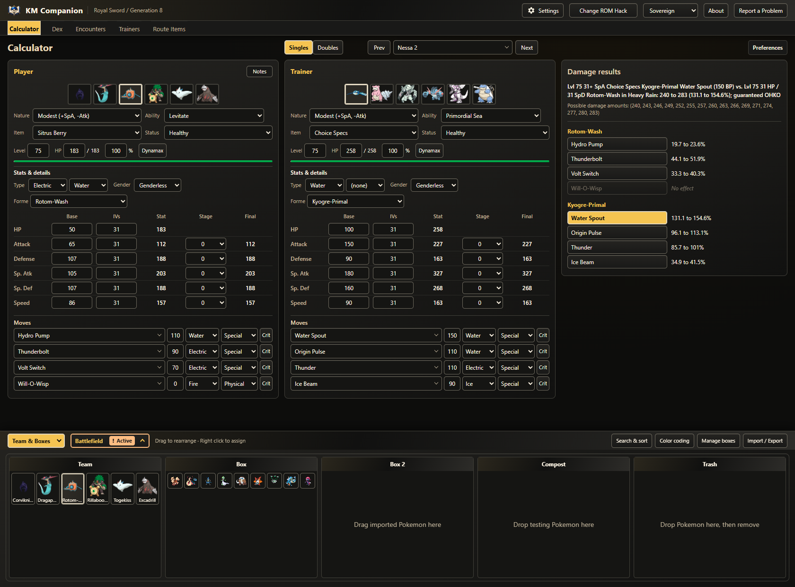
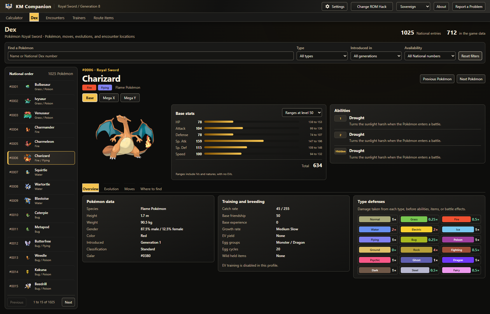

# KM Companion

[](https://github.com/KotMatrosk1n/KM-Companion/releases/latest)

[](LICENSE)

Plan battles and track your run in Pokémon ROM hacks. KM Companion combines damage calculations, team management, a Dex for your ROM hack, and encounter, trainer, and item tracking in a Windows desktop app.

**Pokémon Royal Sword is the first included profile.** Each profile supplies its own game data and rules, keeping your calculations and saved run separate from other hacks.

[Download for Windows](https://github.com/KotMatrosk1n/KM-Companion/releases/latest) | [User guide](docs/app-workspace.md) | [Submit your mod](docs/mod-submissions.md) | [Report an issue](https://github.com/KotMatrosk1n/KM-Companion/issues/new/choose)



*Calculator with sample teams in the Sovereign theme. Screenshots show the current development version; see each download's [release notes](https://github.com/KotMatrosk1n/KM-Companion/releases) for included features.*

## Quick start

1. Download and run the latest Windows x64 setup from [Releases](https://github.com/KotMatrosk1n/KM-Companion/releases/latest), then open KM Companion.
2. At **Which ROM Hack are you playing?**, choose **Pokémon Royal Sword**. The chooser appears on every launch; **Change ROM Hack** returns to it later.
3. Choose **Download artwork** for Pokémon pictures, or **No thanks** to continue without them. **Settings → Artwork** lets you download later.
4. Open **Team & Boxes → Import / Export** to import a compatible save or Pokémon sets, or build your team with the calculator controls. Choose an opponent and start comparing moves.

Installed builds need no Node.js, Git, web server, or separate backend. Windows releases are unsigned, so Windows may identify the publisher as unknown. Use the setup attached to this repository's release.

Moving from a 0.4.x development build? Follow the [development build transition](installer/windows/README.md#upgrade-and-uninstall-behavior). KM Companion was previously called KM Calculator and retains compatible saved teams, notes, settings, progress, and backups.

## Plan your battles

Compare damage rolls, check what your Pokémon can survive, and adjust moves, items, abilities, and spreads. Singles and Doubles keep Pokémon details, stats, and battlefield controls beside the results. Select a trainer's team to plan the next fight without rebuilding it yourself.

Keep six Pokémon in Team and organize the rest across Box, Box 2, Compost, and Trash. Search, sort, color code, and move Pokémon while keeping your matchup in view. The layout adapts to your window and display scaling, with readable names when pictures are unavailable.

Royal Sword uses its own Generation 8 data, disables EV input, and includes a Sword/Shield battle simulator. See the [workspace guide](docs/app-workspace.md) for calculator controls and team management.

## Explore your Dex

Search by name, form, or National Dex number, or browse all **1,025 Pokémon in National order**. Pages bring together the selected hack's base stats, all three ability slots, evolution rules, type defenses, breeding and training facts, and recorded encounter locations.

Open alternate and Mega forms from their base species. Browse **Level up**, **TM**, **TR**, **Tutor**, and **Egg** moves separately, with search and move details inside each group. Missing game records are identified so the National index does not imply every Pokémon is available in your hack.



*Charizard's base form in Pokémon Royal Sword. Stats and abilities reflect the hack's data.*

See the [Dex guide](docs/pokedex.md) for forms, move lists, artwork, and data coverage.

## Keep track of your run

Browse Royal Sword encounters by location, method, and weather, with separate Normal, Royalocke, and Nuzlocke progress. Inspect trainer teams, mark defeated trainers, track collected items, and keep player and trainer notes beside your plans.

Use **Settings → Backup** to back up or restore the selected profile's run, with **Undo Last Restore** available for recovery. **Reset Run** clears encounter, trainer, and item progress after confirmation while retaining teams, boxes, inventory, notes, and settings. Other profiles keep their own runs.

**Route Items currently uses the Sword/Shield 1.3.2 base game guide, including expansions. It is not a verified Royal Sword placement list.** Entries retain source links and known limits. The [workspace guide](docs/app-workspace.md) explains tracking rules and backup scope.

## Artwork, offline use, and updates

Pokémon illustrations and static and animated sprites are an optional download. After the complete download, they work offline alongside calculations, the Dex, and run tracking. **Settings → Artwork** can download, check, repair, pause, or hide pictures. Updates, repairs, and installing over an existing copy keep downloaded artwork; uninstall removes it for the current Windows account while preserving saved runs and settings.

Saves and trainer files are processed locally. Teams, boxes, notes, inventory, and progress are not uploaded. Update checks contact GitHub; artwork downloads contact Pokémon Showdown and PokéAPI's public image repository. Viewing pictures does not fetch missing files automatically.

The app checks for updates after launch. **Settings → Updates** also offers a manual check, release notes, and installation after confirmation.

## Supported coverage

| Area | Coverage |
| --- | --- |
| Included ROM hack | Pokémon Royal Sword, using Generation 8 |
| Calculation engine | Canonical Generations 1 through 9, with explicit profiles for hack changes |
| Save import | Main series save families across Generations 1 through 9, plus supported standalone Pokémon files. See [formats and limits](docs/save-imports.md). |

Save recognition does not add support for another ROM hack. Pokémon and forms must resolve through the active profile before an import can replace Team/Box data. Keep a backup of your original save.

## For mod authors

Want KM Companion to support your game? The [mod submission guide](docs/mod-submissions.md), [starter folder](docs/templates/mod-submission/README.md), and [filled example](docs/examples/mod-submission/README.md) provide readable YAML or JSON files for Pokémon, moves, abilities, items, trainers, encounters, item locations, and custom rules. You can submit a draft without a development setup.

Complete submissions are reviewed for profile integration. To share trainer teams through the existing import tools, use the separate [trainer pack format](docs/trainer-data-packs.md). Include creator credits, public sources, versions, and redistribution permission with your data. [Start a discussion](https://github.com/KotMatrosk1n/KM-Companion/discussions) to describe your game and what its players need.

## Development and contributing

Use Node.js 24 or a later compatible release and npm. After cloning the repository, run:

```powershell
npm ci
npm run electron:dev
```

The [development guide](docs/development.md) covers setup, desktop packaging, and installer prerequisites. Read [Contributing](CONTRIBUTING.md) and the [Code of Conduct](CODE_OF_CONDUCT.md) for focused fixes, compatibility reports, and profile contributions. Report suspected vulnerabilities privately through the [Security Policy](SECURITY.md).

## Credits and license

Built on the Smogon damage calculator, with data or compatibility references from Pokémon Showdown, PokéAPI, PKHeX, and the projects in [Credits](CREDITS.md). See [Contributors](CONTRIBUTORS.md), [dependency notices](THIRD_PARTY_NOTICES.md), and [save import notices](import/THIRD_PARTY_NOTICES.md) for acknowledgements.

The combined app is licensed under [GNU GPL version 3](LICENSE), without warranty. Separately licensed components retain their notices; [Licensing](LICENSING.md) explains those boundaries. Pokémon artwork and other game assets are excluded from the software license and retain their owners' rights.

KM Companion is an unofficial fan project, unaffiliated with Nintendo, Creatures Inc., GAME FREAK inc., The Pokémon Company, or supported hack authors. Pokémon names and trademarks belong to their respective owners. No ROMs, console keys, or save files are included.
